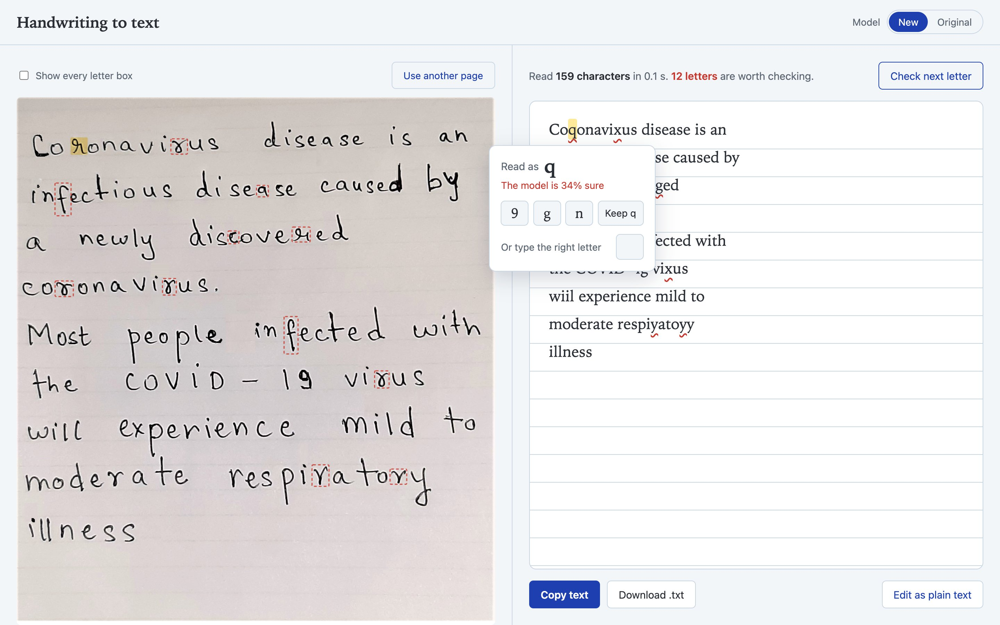

# HandwritingRecognition

Converts a photo of a handwritten page into typed text using a CNN (trained on EMNIST, 47 classes) and OpenCV character segmentation, with a local web app to check and correct the result.



## Setup

```bash
uv venv --python 3.11 .venv
uv pip install --python .venv/bin/python -r requirements.txt
```

## Run

```bash
.venv/bin/python server.py
```

This starts a local server and opens http://127.0.0.1:8765 in your browser. Everything runs on your
computer; images are only sent to this local server.

- Drop a photo of a handwritten page, choose a file, paste an image (⌘V), or try a sample page.
- The typed text appears next to the photo. Point at a letter in either one to see where it is in the other.
- Letters the model was unsure about are underlined in red. Click one (or **Check next letter**) to see
  the model's other readings and pick or type the right letter.
- **Copy text**, **Download .txt**, or **Edit as plain text** for free-form edits.
- Switch between the new and the original model at the top right.

## Accuracy

`evaluate.py` compares the output for every image in `dataset/` with the transcriptions in
`dataset/ground_truth.json` (character accuracy = 1 − edit distance / length, case-insensitive,
because the model's 47 EMNIST classes merge upper and lower case for many letters).

```bash
.venv/bin/python evaluate.py -v
```

| | char accuracy | ignoring spaces |
|---|---|---|
| Original pipeline, original CNN | 89.0% | 87.3% |
| Improved pipeline, original CNN | 96.1% | 95.7% |
| Improved pipeline, new CNN (`train.py`) | **97.9%** | **97.8%** |

The app uses the new CNN (`models/emnist_cnn.keras`) when it is present. To use the original one
(`AZaz09weights`), pick **Original** in the web app, set `HWR_MODEL=original`, or run
`.venv/bin/python evaluate.py --model original`.

How the pipeline gives the CNN cleaner input (see the docstring in `app.py`):
- background normalisation before thresholding, so shadows and show-through from the back of the page are dropped
- line grouping that follows slanted lines, i/j dots attached to their stems, broken strokes merged, and full stops/hyphens detected
- characters rendered like EMNIST samples: aspect ratio kept, normalised stroke width, anti-aliased and blurred
- predictions averaged over a few renderings of each character
- context-aware decoding: a word is read as all letters or all digits unless a switch is strongly supported
- plain vertical bars (which the model cannot tell apart) are resolved from the page: a dot makes "i", a word in capitals makes "I", rising above the local x-height makes "l"
- touching letters ("th", "to") that the model is unsure about are cut at their thinnest column when the model is confident about both halves

A page takes about 0.2 s to recognise (11 sample pages in about 1 s on an M3 MacBook Air).

## Training the new CNN

`train.py` trains a deeper CNN (6 conv layers with batch norm, ~594k parameters) from scratch on
EMNIST "bymerge" (~678k images, same 47 classes as the original model). It runs in PyTorch on the
fastest device available (Apple GPU via MPS on Apple Silicon, CUDA, or CPU), keeps the dataset and the
augmentation (rotation, slant, size, shift, stroke thickness, blur) on the device, and exports the
weights to `models/emnist_cnn.keras` so the app needs no PyTorch.

```bash
uv pip install --python .venv/bin/python -r requirements-train.txt
# download https://biometrics.nist.gov/cs_links/EMNIST/gzip.zip (~560 MB) and extract
# the emnist-bymerge-* and emnist-balanced-* files into data/emnist/gzip/
.venv/bin/python train.py --epochs 10
```

On an M3 MacBook Air, 10 epochs take about 40 minutes. EMNIST balanced test accuracy: original
model 86.7%, new model 89.2%.
